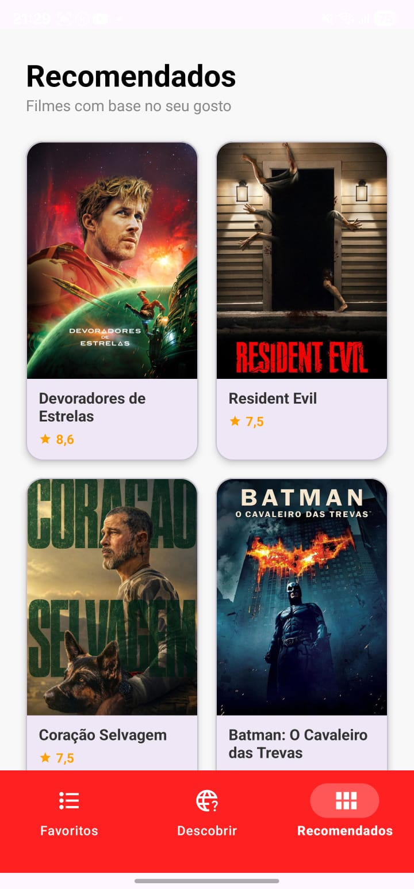
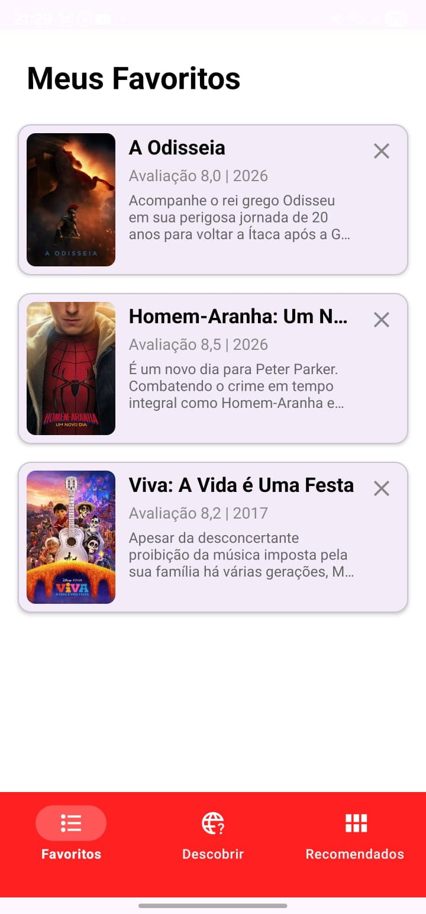
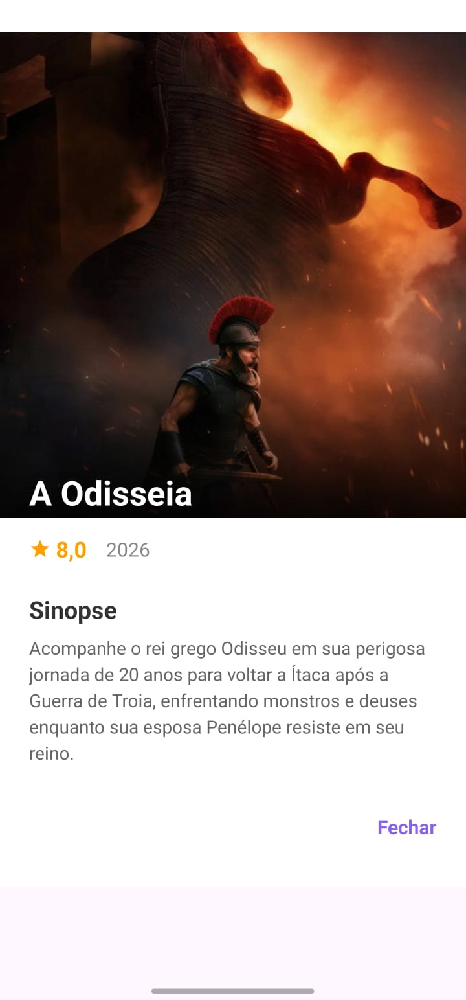

# CineMatch

Aplicativo Android que sugere filmes e aprende o seu gosto conforme você usa. Você desliza os cards de filmes, e o app descobre quais gêneros você mais curte para recomendar filmes parecidos.

O projeto começou como uma atividade passada em aula e evoluiu para um app completo, com login, banco de dados na nuvem e integração com uma API de filmes.

## Telas

<p align="center">
  
  
  
  
</p>

## Funcionalidades

- **Cadastro e login** com e-mail e senha (Firebase Authentication), com mensagens de erro para senha fraca, e-mail já usado, credenciais inválidas e falta de conexão.
- **Descobrir:** cards de filmes que você desliza para avaliar. Também dá pra usar os botões na tela.
    - Para a direita: curtir
    - Para a esquerda: não curtir
    - Para cima: favoritar
- **Contador** de filmes já avaliados e **histórico** de filmes vistos, pra não repetir o mesmo filme.
- **Recomendados:** lista de filmes baseada nos gêneros que você mais curtiu, com carregamento de mais filmes conforme você rola a tela.
- **Favoritos:** lista dos filmes que você favoritou, com opção de remover.
- **Detalhes do filme:** pôster, título, nota, ano de lançamento e sinopse.

## Como as recomendações funcionam

Cada avaliação muda o "peso" dos gêneros do filme no perfil do usuário:

| Gesto | Efeito no peso dos gêneros |
|-------|---------------------------|
| Curtir (direita) | +2 |
| Não curtir (esquerda) | -1 |
| Favoritar (cima) | +5 |

Os pesos ficam salvos no Firestore. As telas de recomendação usam os 3 gêneros com maior peso para buscar filmes na API.

## Tecnologias

- Java 11, Android (minSdk 24, targetSdk 36) e Gradle
- Firebase Authentication e Cloud Firestore
- [The Movie Database (TMDB) API](https://www.themoviedb.org/documentation/api), em português (pt-BR)
- Retrofit e Gson para consumir a API
- Glide para carregar as imagens
- [CardStackView](https://github.com/yuyakaido/CardStackView) para os cards deslizáveis
- Material Components

## Estrutura do projeto

```
app/src/main/java/com/example/a04
├── Adapters     # adapters das listas (Descobrir, Recomendados, Favoritos)
├── api          # interface do Retrofit e modelos (Filme, Results)
├── fragments    # telas Descobrir, Recomendados e Favoritos
├── TelaLogin / TelaCadastro
├── MainActivity # navegação inferior entre os fragments
└── FilmeDetalhes
```

## Estrutura dos dados no Firestore

```
Usuários/{uid}                        → nome
  ├── historico/filmes                → vistos: [ids dos filmes avaliados]
  ├── favoritos/filmes                → lista: [filmes favoritados]
  └── generos/{nome do gênero}        → id, peso
```

## Como rodar

Pré-requisitos: Android Studio, uma chave de API do TMDB e um projeto no Firebase.

1. Clone o repositório e abra no Android Studio.
2. Crie uma conta no [TMDB](https://www.themoviedb.org/) e gere uma chave de API.
3. Crie (ou edite) o arquivo `local.properties` na raiz do projeto e adicione:
   ```
   TMDB_API_KEY=sua_chave_aqui
   ```
4. No [Console do Firebase](https://console.firebase.google.com/), crie um projeto, adicione um app Android com o nome de pacote `com.example.a04` e baixe o `google-services.json` para a pasta `app/`.
5. No Firebase, ative o **Authentication** com o provedor E-mail/senha e crie o banco **Cloud Firestore**.
6. Aplique as regras de segurança abaixo.
7. Rode o app em um emulador ou celular (Android 7.0 ou superior).

### Regras de segurança do Firestore

Cada usuário só pode ler e escrever os próprios dados. A coleção se chama `Usuários` (com acento), e as regras do Firestore não aceitam acento no caminho, por isso o nome é conferido dentro da condição:

```
rules_version = '2';
service cloud.firestore {
  match /databases/{database}/documents {
    match /{colecao}/{userId}/{document=**} {
      allow read, write: if colecao == 'Usuários'
                         && request.auth != null
                         && request.auth.uid == userId;
    }
  }
}
```

## Limitações

- O app não tem testes automatizados além dos exemplos gerados pelo Android Studio.
- A interface e os dados dos filmes estão apenas em português.
- Só há versão para Android.

## Créditos

This product uses the TMDB API but is not endorsed or certified by TMDB.